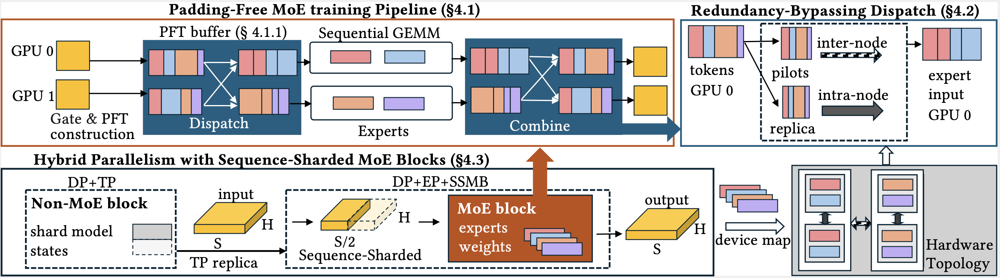
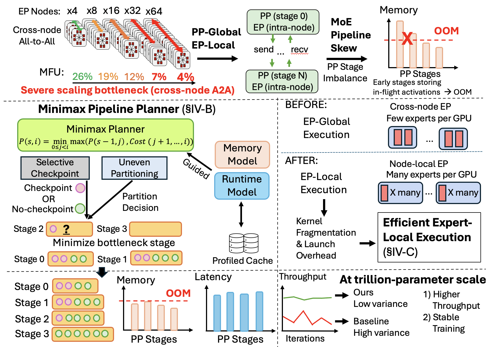
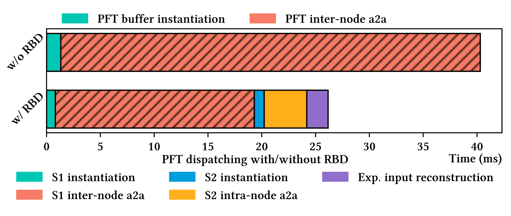
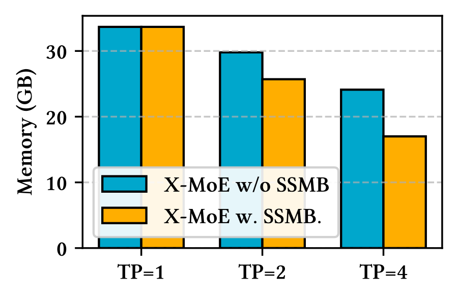
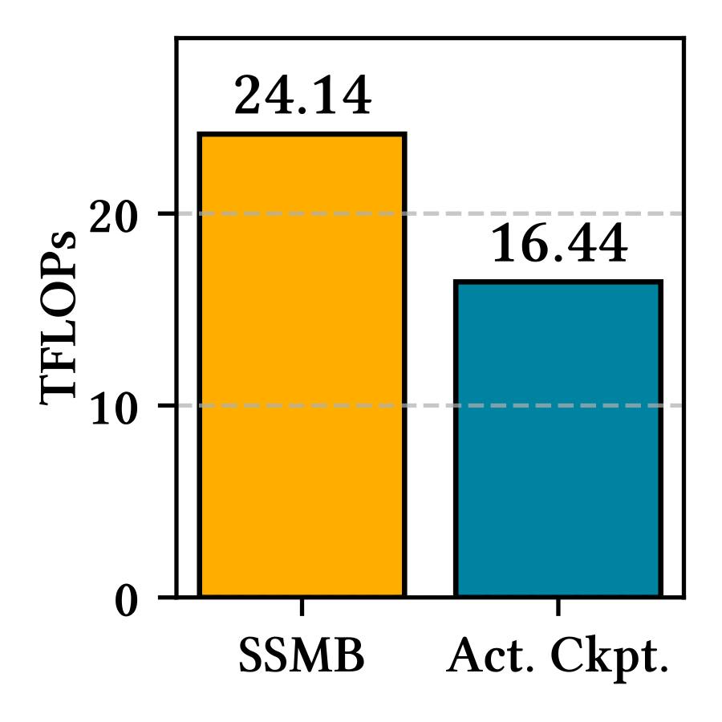
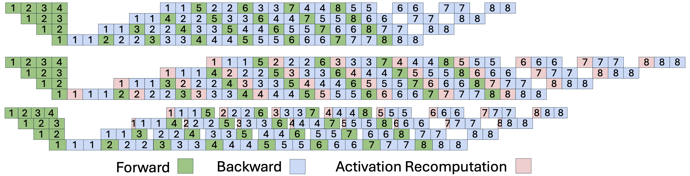
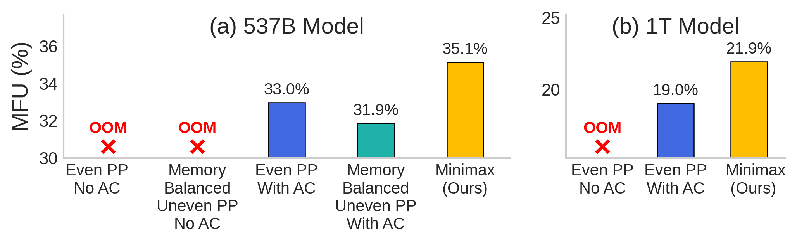
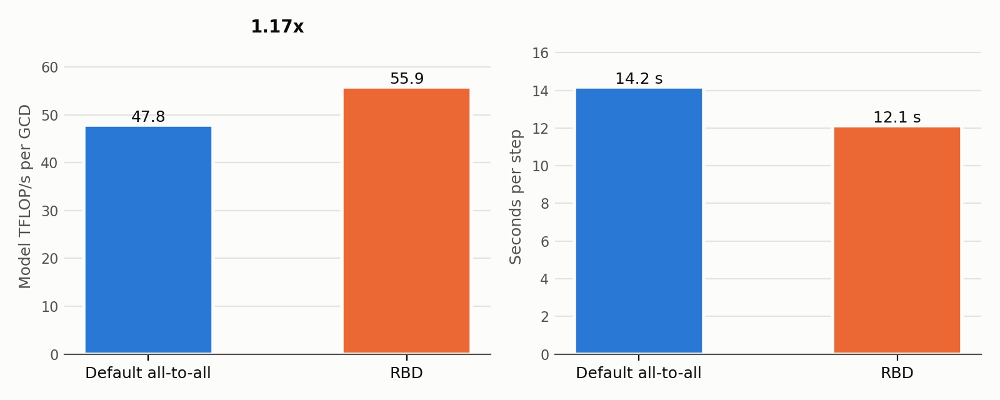
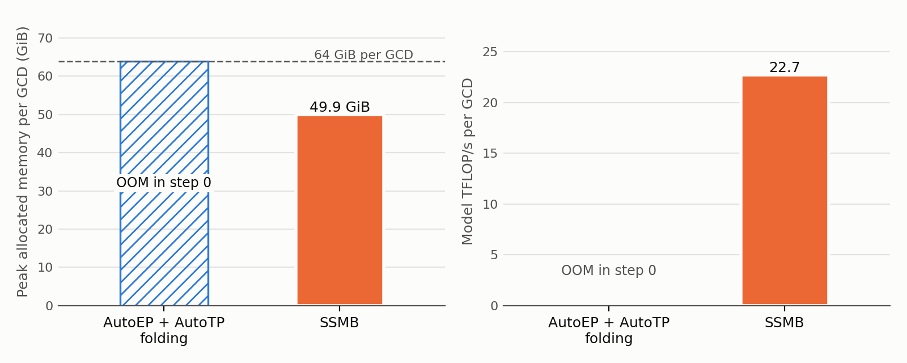
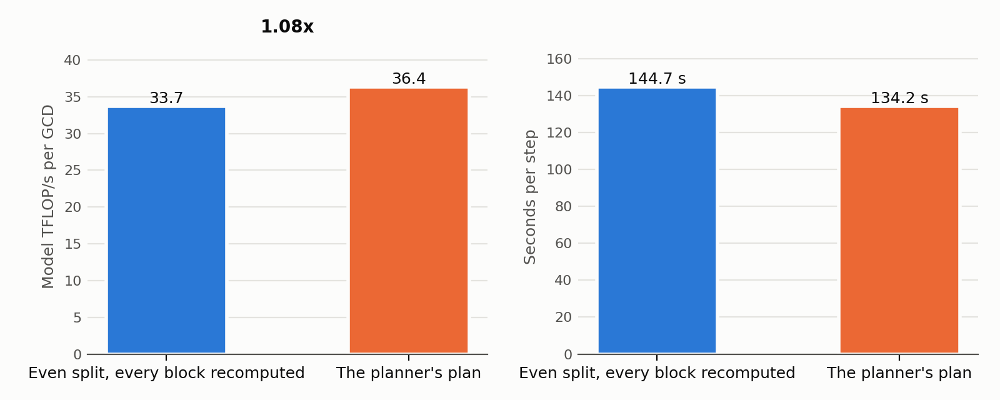

<div align="center">

# DeepSpeed X-MoE: Training Expert-Specialized Mixture-of-Experts Models at Scale

</div>



*Figure 1: Overview of X-MoE (SC 2025): a padding-free MoE pipeline, redundancy-bypassing dispatch (RBD) and
sequence-sharded MoE blocks (SSMB). Figure from the X-MoE paper.*



*Figure 2: Overview of X-MoE-4D (SC 2026): pipeline-global, expert-local execution and the minimax pipeline planner
(ELM-PP). Figure 5 of the X-MoE-4D paper.*

To cite this work, please cite the X-MoE and X-MoE-4D papers:

```
@inproceedings{yuan2025xmoe,
  title     = {X-MoE: Enabling Scalable Training for Emerging Mixture-of-Experts Architectures on HPC Platforms},
  author    = {Yueming Yuan and Ahan Gupta and Jianping Li and Sajal Dash and Feiyi Wang and Minjia Zhang},
  booktitle = {Proceedings of the International Conference for High Performance Computing, Networking, Storage and Analysis (SC)},
  year      = {2025},
  note      = {arXiv:2508.13337}
}

@inproceedings{xmoe4d2026,
  title     = {X-MoE-4D: Breaking the Scaling Barrier for Trillion Parameter MoEs on Hierarchical HPC Systems},
  author    = {Zixian Wang and Liheng Jing and Emily Herron and Sajal Dash and Feiyi Wang and Minjia Zhang},
  booktitle = {Proceedings of the International Conference for High Performance Computing, Networking, Storage and Analysis (SC)},
  year      = {2026}
}
```

# Introduction

Expert-specialized Mixture-of-Experts (MoE) models, such as DeepSeek-V3, use many small experts and route each token to
several of them. At scale, expert parallelism (EP) distributes their experts across many nodes. Every MoE layer then
exchanges tokens between the nodes by all-to-all communication. On HPC systems, the links between nodes are much slower
than the links inside a node and are shared by more traffic. This all-to-all communication therefore limits the
scalability of MoE training.

[X-MoE](https://arxiv.org/abs/2508.13337) (SC 2025) reduces the cost of expert parallelism across nodes. X-MoE-4D (SC
2026) keeps expert parallelism inside each node and scales across nodes with pipeline parallelism. Its pipeline planner
chooses the layers and the recomputation of every stage, so that every stage fits in memory and the time of the slowest
stage is minimized.

This release adds three of these mechanisms to DeepSpeed. Each mechanism is disabled by default and is enabled by its
own configuration key or `PipelineModule` argument:

- **Redundancy-Bypassing Dispatch (RBD)** in AutoEP: `"comm_backend": "two_level"`.
- **Sequence-Sharded MoE Blocks (SSMB)** in AutoEP under AutoTP: `"sequence_sharded_moe": true`.
- **The X-MoE-4D pipeline planner** for `PipelineModule`: per-stage layer and recomputation counts (`layers_per_stage`,
  `activation_checkpoints_per_stage`) and a planner that chooses them (`python -m deepspeed.runtime.pipe.planner`).

RBD and SSMB target layouts in which expert parallelism spans several nodes. The planner targets layouts in which a
pipeline spans several nodes.

# Core Design

## Redundancy-Bypassing Dispatch

AutoEP's default all-to-all sends one row for every pair of a token and a selected expert. With top-8 routing, several
of a token's experts are often on the same node, so the same row crosses the network several times. With 256 experts,
routing spread evenly and an expert-parallel group over 4 nodes, 54.8 % of the rows are such duplicates.

RBD sends each row across the network once per destination node and makes the copies inside the node:

1. For every pair of a token and a destination node, one row, the *pilot*, goes to the rank of one of the token's
   experts on that node.
2. Inside the node, the pilot's rank copies the row to the ranks of the token's other experts on that node.
3. In the combine step, the pilot's rank sums the node's weighted expert outputs into one row and returns that row.

The experts receive the same rows as on the default path, so the result is the same up to the order of floating-point
additions. The cost is a second exchange inside the node. The saving is largest when a group spans a small number of
nodes. For 256 experts and top-8 routing, the number of rows that cross the network decreases by 75 % on 2 nodes, 55 %
on 4, 34 % on 8 and 18 % on 16. RBD uses only DeepSpeed's collectives, so it requires no vendor-specific kernels.

```json
"expert_parallel": {"enabled": true, "autoep_size": 32, "comm_backend": "two_level"}
```



*Figure 3: In X-MoE, RBD reduces the dispatch time of one MoE layer at EP 32 from about 40 ms to about 26 ms (1.55x).
The inter-node all-to-all takes 52.5 % less time, and the added intra-node exchange takes a few milliseconds. Figure 12
of the X-MoE paper.*

## Sequence-Sharded MoE Blocks

Under AutoTP, the ranks of a tensor-parallel group hold the same tokens at the output of the attention block. In
AutoEP's default mode, called *folding*, each rank routes all of the group's tokens and keeps 1/TP of the routed rows.
Folding does not duplicate any expert computation. However, every rank still routes, buffers and gathers the rows of
all tokens.

SSMB shards the tokens instead. At the entry of the MoE block, each rank of a tensor-parallel group keeps 1/TP of the
tokens. It routes, dispatches, runs the experts and combines only its share. The block gathers one row per token at its
exit. The dispatch and combine buffers are therefore smaller by a factor equal to the tensor-parallel size. This
reduction can remove the need for activation checkpointing. The cost is an all-gather of the input gradient in the
backward pass. SSMB requires AutoTP. With `"comm_backend": "two_level"`, RBD runs on SSMB's token shards, as in X-MoE.

```json
"expert_parallel": {"enabled": true, "autoep_size": 64, "sequence_sharded_moe": true},
"tensor_parallel": {"autotp_size": 4}
```

 

*Figure 4: In X-MoE, the memory saving of SSMB grows with the tensor-parallel size (left, Figure 13 of the X-MoE
paper). At similar memory, SSMB reaches 24.14 TFLOP/s per GCD, against 16.44 TFLOP/s per GCD with activation
checkpointing (right, Figure 14 of the X-MoE paper).*

## The X-MoE-4D Pipeline Planner



*Figure 5: The same 4-stage 1F1B pipeline under three plans. Top: no recomputation, which runs out of memory on the
early stages. Middle: recomputation on every stage. Bottom: the planner recomputes only on the early stages and gives
the later stages more layers, so the schedule ends earlier. Figure 6 of the X-MoE-4D paper.*

With expert parallelism inside each node and pipeline parallelism across nodes, the all-to-all stays inside the node.
The pipeline, however, becomes unbalanced. MoE layers need much more activation memory than attention layers. Under the
1F1B schedule, stage s of p stages stores the activations of about p - s micro-batches. The early stages therefore run
out of memory first (Figure 5, top). `PipelineModule` applies one recomputation interval to every stage, so every stage
incurs the recomputation that only the early stages need.

The planner minimizes the time of the slowest stage, subject to the memory limit of every stage. It makes two decisions
per stage. *Selective checkpointing* recomputes only as many blocks as the stage needs to fit in memory. *Uneven
partitioning* moves blocks from the early stages to the later ones. A dynamic program chooses both for all stages:

```
P(s, i) = min over j < i of max( P(s-1, j), Cost(j+1 .. i) )
Cost(l blocks) = min over c recomputed of (l - c) * t_uc + c * t_c, among the c whose memory fits the device
```

P(s, i) is the smallest possible time of the slowest stage when the first i layers form s stages. The runtimes of a
block without and with recomputation, t_uc and t_c, are measured by a profile of each layer type on one node. The
memory of a stage is predicted by a model of ZeRO stage 1 and the 1F1B schedule. The planner prints the two per-stage
lists, which are passed directly to `PipelineModule`:

```bash
python -m deepspeed.runtime.pipe.planner plan --costs costs.json \
    --layers 'Embed,Block*24,Head' --blocks Block --world 128 --pp 8 --ep 8 --global-batch 2048 --device-gib 64
```

```python
PipelineModule(layers=..., num_stages=8, partition_method="type:Block", activation_checkpoint_interval=1,
               layers_per_stage=[3, 3, 3, 3, 3, 3, 3, 3], activation_checkpoints_per_stage=[3, 3, 3, 3, 3, 3, 3, 2])
```

The planner's gain grows with the skew between stages. In the X-MoE-4D paper, on 480 GCDs, the planner reaches 35.1 %
MFU at 537B parameters and 21.9 % MFU at 1T parameters. An even split with recomputation on every stage reaches 33.0 %
and 19.0 %, respectively. An even split without recomputation runs out of memory (Figure 6).



*Figure 6: The planner at 537B and 1T parameters on 480 GCDs. Figure 10 of the X-MoE-4D paper.*

Uneven stages required one change to ZeRO stages 1 and 2. The gradient norm is now reduced across the model-parallel
group once per step instead of once per parameter group. The reduction once per parameter group caused a deadlock in a
pipeline whose stages hold different numbers of parameter groups.

# Key Results

We repeated the papers' experiments with this release on Frontier: AMD MI250X GCDs with 64 GB each, 8 per node, ROCm
6.4, RCCL 2.22.3 with the aws-ofi-rccl 1.4.0 network plugin, PyTorch 2.9.1, bf16 and ZeRO stage 1. The model is the
DeepSpeedExamples decoder at the papers' shapes, with sequence length 4,096. AutoEP runs the experts as a loop of GEMMs
(`use_grouped_mm: false`). Each experiment runs the feature and its baseline in one job, from the same initial weights
and batches. It reports model TFLOP/s per GCD as the mean over the steps after a warm-up. The data-parallel degree of
the non-MoE layers is GCDs / (TP x PP), and that of the experts is GCDs / (PP x EP).

| Experiment | Model | GCDs | TP | PP | EP | DP, non-MoE layers | DP, experts | Sequences per step | Baseline | Feature |
|---|---|---|---|---|---|---|---|---|---|---|
| X-MoE Fig. 12 | one MoE layer of X-MoE's Large (hidden 7168, 256 experts, top-8) | 32 | 1 | 1 | 32 | 32 | 1 | 1,024 | default all-to-all | RBD |
| X-MoE Fig. 13 | X-MoE's Large, 28 layers (201B) | 256 | 4 | 1 | 64 | 64 | 4 | 1,024 | AutoEP + AutoTP folding | SSMB |
| X-MoE-4D planner | X-MoE-4D's 173B, 24 layers | 128 | 1 | 8 | 8 | 16 | 2 | 2,048 | even split, every block recomputed | the plan |

**RBD.** On one MoE layer of X-MoE's Large model at EP 32 over 4 nodes, RBD raises throughput from 47.8 to 55.9 model
TFLOP/s per GCD (1.17x). The loss stays within 1e-5 of the baseline at every step (Figure 7).



*Figure 7: RBD on one MoE layer of X-MoE's Large model, EP 32 over 4 nodes.*

**SSMB.** On X-MoE's Large model at TP 4 x EP 64 over 32 nodes without recomputation, AutoEP + AutoTP folding is OOM in
step 0. SSMB trains the same layout at a peak of 49.9 GiB per GCD and 22.7 model TFLOP/s per GCD (Figure 8).



*Figure 8: SSMB on X-MoE's Large model, TP 4 x EP 64 over 32 nodes.*

**Pipeline planner.** On X-MoE-4D's 173B model with PP 8, EP 8, TP 1 and expert DP 2 on 128 GCDs, the plan raises
throughput by 8 % over the even split with every block recomputed, from 33.7 to 36.4 model TFLOP/s per GCD (Figure 9).



*Figure 9: The planner on X-MoE-4D's 173B model, PP 8 x EP 8 over 16 nodes.*

# General Availability of DeepSpeed X-MoE

The three features are available in DeepSpeed from version *TBD*. RBD and SSMB are enabled by two keys in the
`expert_parallel` section of the DeepSpeed config ([AutoEP
documentation](https://deepspeed.readthedocs.io/en/latest/autoep.html)). They require no change to a model that AutoEP
converts. The planner requires the model as a `PipelineModule` and a profile of each layer type measured in its actual
expert-parallel group. The [pipeline tutorial](https://www.deepspeed.ai/tutorials/pipeline/) explains both in "Choosing
the split with the planner".
[DeepSpeedExamples/training/xmoe](https://github.com/zixianwang2022/DeepSpeedExamples/tree/xmoe/training/xmoe) contains
a profile script and the scripts that run each feature against its baseline and repeat the three experiments above.

What has been validated, and what has not:

- **Validated:** AMD MI250X GPUs with ROCm, bf16 and ZeRO stage 1 in training. Unit tests also match SSMB's gradients
  to its baselines under ZeRO stages 0 to 3. RBD and SSMB are validated at pipeline size 1, and the planner is
  validated without tensor parallelism.
- **Not yet validated:** NVIDIA GPUs, training with ZeRO stages 2 and 3, offloading, fp16, fp32 gradient accumulation
  in the planner's memory model, the planner with tensor parallelism, and RBD with a trained model's own routing.
- **Limits:** RBD improves throughput only when an expert-parallel group spans several nodes. It identifies the ranks
  of a node by host name. RBD and SSMB do not support pipeline parallelism. The planner's memory model covers ZeRO
  stage 1, bf16 and the 1F1B schedule. Because AutoEP drops no token, the memory of a block grows with the number of
  rows that its rank receives. The memory of a block should therefore be profiled at the routing imbalance expected in
  training (the example's `--routing-imbalance`).

We welcome contributions and collaboration from the open-source community.

# Acknowledgements and Contributions

This work was done at the University of Illinois Urbana-Champaign and Oak Ridge National Laboratory, and used resources
of the Oak Ridge Leadership Computing Facility. We thank the DeepSpeed team for the AutoEP and AutoTP foundations this
work builds on. Liheng Jing made the first port of the X-MoE-4D planner to DeepSpeed.

Contributions: X-MoE: Yueming Yuan, Ahan Gupta, Jianping Li, Sajal Dash, Feiyi Wang, Minjia Zhang. X-MoE-4D: Zixian
Wang, Liheng Jing, Emily Herron, Sajal Dash, Feiyi Wang, Minjia Zhang. DeepSpeed integration: Zixian Wang, Liheng Jing.
